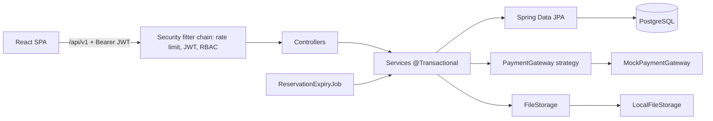

# Architecture

Modular monolith, layered: `controller → service → repository → entity`, with DTO records at the API boundary (entities are never returned).

## Packages (`com.inventorymanagement`)
`config` (properties, security, OpenAPI, seeder) · `controller` · `service` · `repository` · `entity` · `dto` · `security` · `exception` · `enums` · `payment` · `storage` · `scheduler` · `util`.
Deviations from the brief: services are concrete classes (no `impl` interface pairs), DTOs are grouped as records per module, and explicit mapping is used instead of MapStruct. Interfaces exist where there is a real second implementation (`PaymentGateway`, `FileStorage`).

## Concurrency control
Stock changes go through `InventoryService` only. Each mutation takes `SELECT ... FOR UPDATE` on the inventory row(s) in ascending id order, re-checks rules on the locked row, and writes an `inventory_movements` row in the same transaction. `@Version` is a second safety net; CHECK constraints (`available_quantity >= 0`) are the last line of defence.

Example: stock = 10, 30 buyers each reserve 1 at once. Buyer 1 locks the row, moves 1 available→reserved, commits. Buyers 2..30 wait on the lock and re-read the committed value. After 10 successes, buyer 11 sees `available = 0` and gets `InsufficientStockException`. Result: exactly 10 reservations (`InventoryConcurrencyIT`).

Deadlock avoidance: orders reserve products in ascending product id; transfers lock both warehouse rows with one ordered query; payment/refund/cancel always lock *order then payment*.

## Order & payment flow
1. **TX1 `placeOrder`**: idempotency record (unique `(user, scope, key)`), re-price from DB, reserve stock, create `PENDING` order + snapshots, clear cart.
2. **TX-A `initiate`**: create `Payment(INITIATED)`.
3. **Gateway call, outside any DB transaction.**
4. **TX-B `settle`** (idempotent): success → `CONFIRMED` + `SALE_OUT`; failure → payment `FAILED`, order stays `PENDING` (retry allowed until expiry). If the order expired while the charge was in flight, the charge is auto-refunded.
5. **Scheduler** cancels expired `PENDING` orders and releases reservations (one transaction per order, row-locked, safe to run twice).

## Security
BCrypt passwords; 15-minute JWT access tokens (held in memory by the SPA); 7-day refresh tokens stored hashed, rotated on every use, with reuse detection that revokes the whole family; HttpOnly + SameSite=Strict cookie scoped to `/api/v1/auth`; lockout after 5 failures; per-IP rate limit on login/register; authorities read from the DB per request so role changes apply immediately; ownership checks inside queries (another user's order/address is a 404).
