# Database design

Schema lives in `backend/src/main/resources/db/migration/V1__init_schema.sql` (Flyway). Hibernate runs with `ddl-auto: validate`.
Conventions: `NUMERIC(12,2)` for money, `TIMESTAMPTZ` (UTC), identity PKs, CHECK constraints for every enum-like column, soft delete (`deleted_at`) on users, products, addresses, suppliers.

```mermaid
erDiagram
  USERS ||--o{ USER_ROLES : has
  ROLES ||--o{ USER_ROLES : grants
  ROLES ||--o{ ROLE_PERMISSIONS : has
  PERMISSIONS ||--o{ ROLE_PERMISSIONS : in
  USERS ||--o{ REFRESH_TOKENS : owns
  USERS ||--o{ ADDRESSES : has
  USERS ||--|| CARTS : owns
  CARTS ||--o{ CART_ITEMS : contains
  CATEGORIES ||--o{ CATEGORIES : parent_of
  CATEGORIES ||--o{ PRODUCTS : classifies
  PRODUCTS ||--o{ PRODUCT_IMAGES : has
  PRODUCTS ||--o{ CART_ITEMS : in
  PRODUCTS ||--o{ INVENTORY : stocked_as
  WAREHOUSES ||--o{ INVENTORY : holds
  WAREHOUSES ||--o{ WAREHOUSE_STAFF : staffed_by
  PRODUCTS ||--o{ INVENTORY_MOVEMENTS : audited_by
  WAREHOUSES ||--o{ INVENTORY_MOVEMENTS : at
  SUPPLIERS ||--o{ SUPPLIER_PRODUCTS : supplies
  SUPPLIERS ||--o{ PURCHASE_ORDERS : receives
  PURCHASE_ORDERS ||--o{ PURCHASE_ORDER_ITEMS : lists
  PURCHASE_ORDERS ||--o{ GOODS_RECEIPTS : fulfilled_by
  GOODS_RECEIPTS ||--o{ GOODS_RECEIPT_ITEMS : lists
  USERS ||--o{ ORDERS : places
  ORDERS ||--o{ ORDER_ITEMS : contains
  ORDERS ||--o{ ORDER_STATUS_HISTORY : tracks
  ORDERS ||--o{ PAYMENTS : paid_by
  PAYMENTS ||--o{ REFUNDS : refunded_by
  ORDERS ||--o| SHIPMENTS : shipped_as
  SHIPMENTS ||--o{ SHIPMENT_STATUS_HISTORY : tracks
  ORDERS ||--o{ RETURNS : returned_via
  RETURNS ||--o{ RETURN_ITEMS : lists
  ORDER_ITEMS ||--o{ RETURN_ITEMS : returned
  USERS ||--o{ NOTIFICATIONS : receives
  PRODUCTS ||--o{ PRODUCT_REVIEWS : reviewed_in
  USERS ||--o{ AUDIT_LOGS : performs
  USERS ||--o{ IDEMPOTENCY_RECORDS : scopes
```

## Why the key relationships exist
- **inventory (product × warehouse, unique)**: independent stock per warehouse; `available` and `reserved` are separate buckets so reservation is a move between them.
- **inventory_movements**: append-only ledger with before/after for both buckets. A partial unique index `(reference_type, reference_id, movement_type, product_id, warehouse_id)` makes retried operations unable to move stock twice.
- **order_items snapshots** (name, SKU, list/unit price, tax rate): historical invoices stay correct when products change.
- **orders.shipping_address / billing_address** are JSON snapshots, so editing an address later does not rewrite history.
- **payments.idempotency_key (unique)** and **idempotency_records** stop duplicate charges and orders on retries.
- **refresh_tokens.family_id** lets reuse detection revoke every descendant of a stolen token.
- **Partial unique indexes**: one default address per user; SKU unique among non-deleted products.
